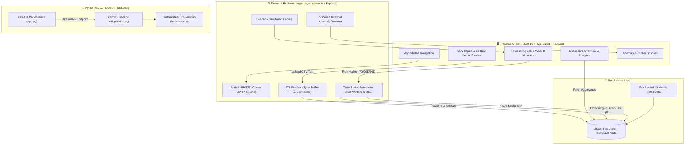

<div align="center">

# 🚀 SmartSales — Sales Forecasting & Analytics Platform
### *Enterprise ML-Powered Sales Forecasting, ETL Ingestion & Automated Anomaly Detection*

[](https://smartsales.ai.studio.)
[](https://opensource.org/licenses/MIT)
[](https://www.typescriptlang.org/)
[](https://react.dev/)
[](https://tailwindcss.com/)
[](https://expressjs.com/)
[](https://www.python.org/)
[](https://fastapi.tiangolo.com/)

**🌐 Production Deployment URL:** [https://smartsales.ai.studio.](https://smartsales.ai.studio.)

</div>

---

## 📌 Table of Contents
- [Overview](#-overview)
- [Key Features](#-key-features)
- [Tech Stack & Logos](#-tech-stack--technologies)
- [System Architecture & Flowchart](#-system-architecture--project-flow)
- [Machine Learning & Mathematical Forecasting](#-machine-learning--mathematical-forecasting)
- [ETL Data Pipeline](#-etl-data-engineering-pipeline)
- [Installation & Quick Start](#-installation--quick-start)
- [API Reference](#-api-endpoints)
- [License](#-license)
- [Author & Connect](#-author--connect)

---

## 🌟 Overview

**SmartSales** is an end-to-end, full-stack sales forecasting and data intelligence platform designed for **Data Scientists, Machine Learning Engineers, and Revenue Analysts**. 

Unlike mock dashboard demos, SmartSales implements **genuine statistical time-series algorithms** (Holt-Winters Double Exponential Smoothing, Linear Trend with Day-of-Week Seasonality, and Moving Average Baselines), strict chronological train/test holdout validation ($MAE$, $RMSE$, $MAPE$), a resilient automated CSV ingestion ETL pipeline with live schema profiling, What-If simulation stress testing, and real-time statistical outlier detection.

---

## 🎯 Key Features

- **Automated CSV Ingestion & ETL Pipeline**: Delimiter sniffing, type inference (`date`, `number`, `string`), schema auto-mapping, and interactive **First 10 Sample Records Preview** table with mapped signal indicators.
- **Statistical Time-Series Forecasting**:
  - *Holt-Winters Double Exponential Smoothing* with grid-search hyperparameter optimization ($\alpha, \beta$).
  - *Linear Trend + Day-of-Week Cyclical Seasonality* using Ordinary Least Squares (OLS).
  - *Moving Average Baseline* for benchmark comparisons.
  - Strict **20% chronological holdout test set** with real Mean Absolute Error ($MAE$), Root Mean Squared Error ($RMSE$), and Mean Absolute Percentage Error ($MAPE$).
  - Expanding 95% Confidence Intervals ($\pm 1.96 \cdot \sigma \cdot \sqrt{h}$).
- **Interactive What-If Sales Simulator**: Live stress-testing levers for marketing budget changes, price elasticity, seasonality, and conversion rate lifts with dual trajectory charts.
- **Statistical Anomaly & Outlier Scanner**: Automated rolling 14-day Z-Score analysis ($Z \ge 2.0\sigma$) detecting revenue surges, drops, and zero-sales outages with incident ledgers.
- **Product & Category Analytics**: Ingested transaction aggregations, departmental revenue shares, top/declining SKUs, and tabular CSV exports.
- **Multi-Theme Canvas**: Instant switching between *Pure Crisp White*, *Slate Charcoal*, and *Midnight Indigo* modes.
- **Enterprise Security**: PBKDF2 with SHA-512 cryptographic password hashing, HMAC-SHA256 signed session tokens, and cross-user data isolation.

---

## 🛠 Tech Stack & Technologies

### Frontend
| Technology | Badge / Logo | Purpose |
|---|---|---|
| **React 19** |  | Dynamic UI component architecture & hooks |
| **TypeScript** |  | End-to-end type safety & data contracts |
| **Vite 8** |  | Blazing-fast build tool & dev middleware |
| **Tailwind CSS v4** |  | Modern utility styling with dark variant support |
| **Recharts** |  | Composed charts, confidence bands, & tooltips |
| **Lucide Icons** |  | Crisp accessible iconography |

### Backend & Data Engineering
| Technology | Badge / Logo | Purpose |
|---|---|---|
| **Node.js & Express** |   | High-performance full-stack API server |
| **Python 3.11** |  | Companion data science & ML microservice |
| **FastAPI** |  | OpenAPI documented REST microservice |
| **Pandas & NumPy** |   | High-throughput data frames & matrix algebra |
| **Statsmodels** |  | Exponential smoothing & time-series analysis |
| **Scikit-learn** |  | Linear regression & model evaluation metrics |
| **MongoDB / File DB** |  | Persistent document storage with local fallback |

---

## 📐 System Architecture & Project Flow



---

## 📊 Machine Learning & Mathematical Forecasting

### 1. Holt-Winters Double Exponential Smoothing (Level + Trend)
$$\ell_t = \alpha y_t + (1 - \alpha)(\ell_{t-1} + b_{t-1})$$
$$b_t = \beta(\ell_t - \ell_{t-1}) + (1 - \beta)b_{t-1}$$
$$\hat{y}_{t+h} = \ell_t + h \cdot b_t$$
*Parameters $\alpha \in [0.1, 0.9]$ and $\beta \in [0.05, 0.3]$ are dynamically selected through a training grid search minimizing root-mean-squared error.*

### 2. Chronological Holdout Validation Metrics
- **Mean Absolute Error (MAE)**:
  $$MAE = \frac{1}{N} \sum_{i=1}^{N} |y_i - \hat{y}_i|$$
- **Root Mean Squared Error (RMSE)**:
  $$RMSE = \sqrt{\frac{1}{N} \sum_{i=1}^{N} (y_i - \hat{y}_i)^2}$$
- **Mean Absolute Percentage Error (MAPE)**:
  $$MAPE = \frac{1}{K} \sum_{y_i \ne 0} \frac{|y_i - \hat{y}_i|}{|y_i|} \times 100\%$$

### 3. Expanding 95% Confidence Bands
$$\text{Interval} = \hat{y}_{t+h} \pm 1.96 \cdot \sigma_{\text{residuals}} \cdot \sqrt{1 + \frac{h}{10}}$$

---

## ⚡ ETL Data Engineering Pipeline

```
[Raw CSV Text] ──► [PapaParse / Sniffer] ──► [Type Inference (Date / Number)] 
       │
       ▼
[Column Mapping (Date, Sales, Product, Category, Qty)]
       │
       ▼
[Date Standardization (ISO YYYY-MM-DD)] ──► [Outlier & Negative Detection]
       │
       ▼
[First 10 Sample Records Preview Table] ──► [Validation Log & Ingestion DB]
```

---

## 🚀 Installation & Quick Start

### 1. Clone the Repository
```bash
git clone https://github.com/your-username/smartsales.git
cd smartsales
```

### 2. Install Dependencies
```bash
npm install
```

### 3. Configure Environment Variables
Copy `.env.example` to `.env`:
```bash
cp .env.example .env
```
*(Optional: Provide `MONGODB_URI` for MongoDB Atlas; defaults to persistent file storage at `.data/smartsales_db.json`).*

### 4. Run Development Server
```bash
npm run dev
```
Visit **`http://localhost:3000`** in your browser.

### 5. Production Build
```bash
npm run build
npm start
```

### 6. (Optional) Run Python FastAPI Microservice
```bash
cd backend
python -m venv venv
source venv/bin/activate  # On Windows: venv\Scripts\activate
pip install -r requirements.txt
python app.py
```
*Interactive Swagger docs available at `http://localhost:8000/docs`.*

---

## 📡 API Endpoints

| Method | Endpoint | Description |
|---|---|---|
| `POST` | `/api/auth/register` | Register new analyst account |
| `POST` | `/api/auth/login` | Sign in & receive session token |
| `GET` | `/api/auth/me` | Fetch authenticated user profile |
| `POST` | `/api/datasets/upload/profile` | Sniff CSV headers & infer types |
| `POST` | `/api/datasets/upload/import` | Validate & persist dataset via ETL |
| `GET` | `/api/datasets/:id/analytics` | Fetch sales time-series & category aggregates |
| `POST` | `/api/datasets/:id/forecast` | Run Holt-Winters / Linear model with holdout split |
| `GET` | `/api/forecasts/:id/export` | Export forecast schedule as CSV |
| `POST` | `/api/reports` | Compile executive audit report |
| `GET` | `/api/samples/download` | Download 12-month raw CSV template |
| `GET` | `/api/health` | Service health status check |

---

## 📄 License

Distributed under the **MIT License**. See [`LICENSE`](./LICENSE) for full details.

---

## 👨‍💻 Author & Connect

<div align="left">

**Sonu Kumar**  
*Full-Stack Engineer & Data/ML Enthusiast*

- 🌐 **Live Platform Application**: [https://smartsales.ai.studio.](https://smartsales.ai.studio.)
- 💼 **Personal Portfolio**: [https://animated-portfolio-pro.vercel.app/](https://animated-portfolio-pro.vercel.app/)
- 🔗 **LinkedIn Profile**: [https://www.linkedin.com/in/sonu-kumar-3234bb344/](https://www.linkedin.com/in/sonu-kumar-3234bb344/)
- 📧 **Direct Email**: [sonukr7435@gmail.com](mailto:sonukr7435@gmail.com)

</div>

---
<div align="center">
  <sub>Built with ❤️ by Sonu Kumar · SmartSales Enterprise Forecasting & Analytics Platform</sub>
</div>
